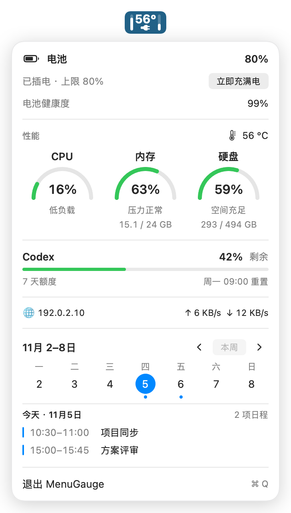
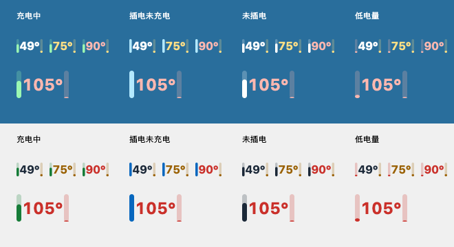

# MenuGauge

MenuGauge 是一个原生 macOS 菜单栏小工具。扫一眼能看电量、CPU 温度和 Codex 剩余额度，点开还能看性能、网速和一周日程。



界面预览使用示例数据。

## 下载试用

在 [v0.2.1 Release](https://github.com/Yuang-Deng/MenuGauge/releases/tag/v0.2.1) 下载 `MenuGauge-0.2.1-arm64-preview.zip`。这是 Apple 芯片 Mac 的预览包，解压后把 MenuGauge 拖进「应用程序」再打开。

预览包尚未经过 Apple 公证。如果第一次打开时 macOS 提示无法验证开发者，确认文件来自本仓库后，可在「系统设置 → 隐私与安全性」为 MenuGauge 选择「仍要打开」。也可以按下文在本机从源码构建。 [Apple 打开下载应用的说明](https://support.apple.com/zh-cn/102445)

## 构建和运行

首版在 Apple M4 Pro、macOS 26.6 上实测。项目最低构建目标为 macOS 13，构建需要 Xcode 15 或更新版对应的 Command Line Tools。

```sh
./scripts/build.sh
open 'dist/MenuGauge.app'
```

启动后从菜单栏打开面板。需要看日程时，在面板底部点「连接日历」并在 macOS 弹窗中授权。Codex 额度需要本机装有 Codex 或 ChatGPT 桌面应用并登录。

## 功能



菜单栏配色使用示例数据，上排为深色背景，下排为浅色背景。四列分别展示充电中、插电未充电、未插电和低电量；每列包含正常、黄色、红色及三位数温度。

- 实心双柱图标：左柱显示电量，右柱显示 Codex 剩余额度；标准菜单栏下图形为 38 × 22 pt。
- 中间始终以大号粗体显示 CPU 温度，例如 `55°`，单位为摄氏度，每两秒刷新。温度独立配色：默认按显示温度在 70°C 起变黄、85°C 起变红，低于 70°C 使用原生黑白色；在面板性能区点击「温度颜色设置」可调整并自动保存两个阈值，范围为 30–110°C，黄色阈值须低于红色阈值。
- 展开原生紧凑面板，按电池、性能、Codex、网络、日历分组，支持浅色和深色外观；点击图标可开关，点击外部或按 Esc 关闭。
- CPU、内存、硬盘使用率以三个横排仪表盘显示。CPU 和内存每两秒刷新。CPU 是全部核心平均使用率（0–100%），低于 50% 为绿、50–80% 为黄、80% 起为红。内存弧长表示占用率，颜色取系统实际内存压力（正常 / 警告 / 紧张）；读取压力失败时显示中性颜色和“压力未知”。内存包含应用、固定内存和压缩存储，不计可回收文件缓存，面板直接显示已用和总容量。
- 左柱以颜色区分供电：充电中为绿色，插电未充电为蓝色，正常使用电池为原生黑白色；未充电且电量不超过 20% 时优先显示红色。菜单栏不再显示闪电或插头，温度在所有供电状态下都居中占满；拔电后面板显示“使用电池”并隐藏充满电按钮。
- 右柱独立显示 Codex 剩余额度：高于 20% 为绿色，20% 及以下为黄色，5% 及以下为红色；旧数据降低亮度并使用中性色，未知额度保留分段标记。
- 硬盘显示启动磁盘的已用比例及已用 / 总容量（十进制 GB）；低于 80% 为绿、80% 起为黄、90% 起为红。容量按 APFS 共享容器统计，不将可清理空间算作空闲；启动、唤醒、打开面板及每分钟刷新。
- 电源状态下提供「立即充满电」：插电且系统存在充电上限或允许覆盖的优化充电暂停时可用。仅点击后才调用系统临时充满接口；失败会显示原因，充电图标始终以系统实际状态为准。使用 macOS 私有 PowerUI 接口，并检查运行时接口签名；不支持的系统会禁用按钮。
- 透明背景，根据菜单栏深浅适配配色。点击图标或悬停可查看完整数值；菜单中可以退出。
- 面板底部显示周历。点「连接日历」并授权后，日期下方的圆点表示有安排，点击日期查看当天的时间和标题。日程直接读取 Mac「日历」App 已同步的事件，在本机显示。
- Codex 额度下方提供折叠的模型检测摘要，点击可看日志、指纹结果、结果时间，并切换最近 48 小时内的会话。面板打开时每 15 秒读取会话并增量检查本地日志；设置变化可能来自用户操作，不能单凭变化认定降配。
- 「检测」由用户手动发起，创建三个临时会话副本，沿用原会话的模型和推理级别生成数字并在本机评分，会使用 Codex 额度。原会话不会被追加探测消息，临时副本不出现在持久会话列表。探测进程关闭 Hooks、Shell 和网页搜索，拒绝授权请求；检测到工具尝试、超时或无有效回答时停止并说明原因，可点「停止」。Ultra 推理暂不支持。结果超过 30 分钟、账户或会话模型设置变化后标记过期。
- 「模型库」展示 6.1 Sol、6.1 Terra 的实验基线状态。缺少基线时可采集最多 36 份参考回答，支持停止后继续；采集后需另行完成校准和独立验证。实验基线的推理级别、参考规模、验证数量及来源可在模型库中查看。当前 Sol 基线仅在 low 级别独立验证，其他级别显示「实验结果待验证」。指纹概率仅表示候选库内的统计归因，不能证明服务端实际加载的权重，也不是模型能力评分。
- 展开菜单将旗帜、本机地址和网速放在同一行，每秒更新，收起菜单后停止采样。地址优先显示 IPv4，否则显示 IPv6。旗帜由 [ipwho.is](https://ipwhois.io/documentation) 根据 HTTPS 请求的公网出口判断，结果缓存五分钟。查询中或失败时显示 🌐，悬停查看详细信息。网速通过系统 nettop 按进程计数差值估算，短暂建立并关闭的连接可能漏计。

Codex 额度复用本机 Codex 桌面应用的登录状态，通过其内置程序的 `account/rateLimits/read` 接口读取，不复制认证凭据、不创建对话或调用模型。启动、每分钟以及唤醒后查询，查询结束退出子进程。仅使用 `codex` 额度桶；多周期取最低剩余比例，菜单分别显示周期与本地时间的重置时间。查询失败时保留旧数据并标记过期，右柱降低亮度；超过五分钟未成功更新或尚无数据时，右柱显示分段的未知标记。未登录、缺少程序等错误可在额度菜单项的提示中查看。需要安装 Codex/ChatGPT 桌面应用，应用升级改变内置程序位置时可能需要适配。[官方协议](https://learn.chatgpt.com/docs/app-server#6-rate-limits-chatgpt)。

CPU 温度是已识别的 CPU 传感器最高值。当前温度读取适配 Apple M4 系列，并已在 M4 Pro 上验证。通过只读 AppleSMC 接口获取，不需要管理员权限；传感器不可用时显示 `—`，菜单说明错误。AppleSMC 是非公开接口，系统或芯片变化可能需要更新适配。M4 传感器映射参考 [Stats](https://github.com/exelban/stats/blob/master/Modules/Sensors/values.swift)，许可证见 [第三方声明](THIRD_PARTY_NOTICES.txt)。

图标会依据菜单栏的深浅外观调整配色。不自动添加登录项，不采集音量，不更改风扇、网络或系统菜单栏设置；电池控制仅执行用户点击的临时充满请求，不修改充电上限配置。

模型检测通过独立的 Codex app-server 连接运行，副本与桌面自身连接的服务端路由可能存在差异。新模型参考数据采自 Codex 订阅线路的 Low 推理设置，属于实验基线；有限样本上的校准或验证通过，不保证其他推理设置和未来模型版本的识别效果。应用使用 Swift 原生评分，运行时无需 Python 或额外插件。

检测结果和自行采集的数字参考保存在 `~/Library/Application Support/MenuGauge/ModelChecks/`，账户信息仅保存哈希；MenuGauge 不读取或复制 `auth.json` 的认证凭据。会话日志在本机检查，主动探测通过本机 Codex 登录的账户请求推理，结果不会上传至本项目的服务器。

维护指纹库时，使用第三方声明中固定版本的 ModelTrace 源码及参考数据，并在装有 NumPy 的开发环境运行：

```sh
python scripts/calibrate-model-bank.py --modeltrace-dir /path/to/ModelTrace --samples /path/to/samples.json
```

支持应用采集的 `*-samples.json`；两款新模型均需完整的 36 个挑战。独立验证记录可使用含 `kind: "validation"`、`source`、`challenge_id`、`expected_count`、`text` 的 JSONL 一并输入。采样文件仅在本机读取，脚本重建统计库和校准参数，并更新来源及 Swift 评分对照样本。

## 本地检查

```sh
./scripts/test.sh
.build/release/StatusRing --snapshot
```

`--snapshot` 输出真实电量、供电状态、CPU 最高温度，CPU / 内存使用率、系统内存压力、硬盘使用率及容量、当前 IP 地址以及真实 Codex 额度与重置时间，便于核对。

项目采用 [MIT 许可证](LICENSE)。
